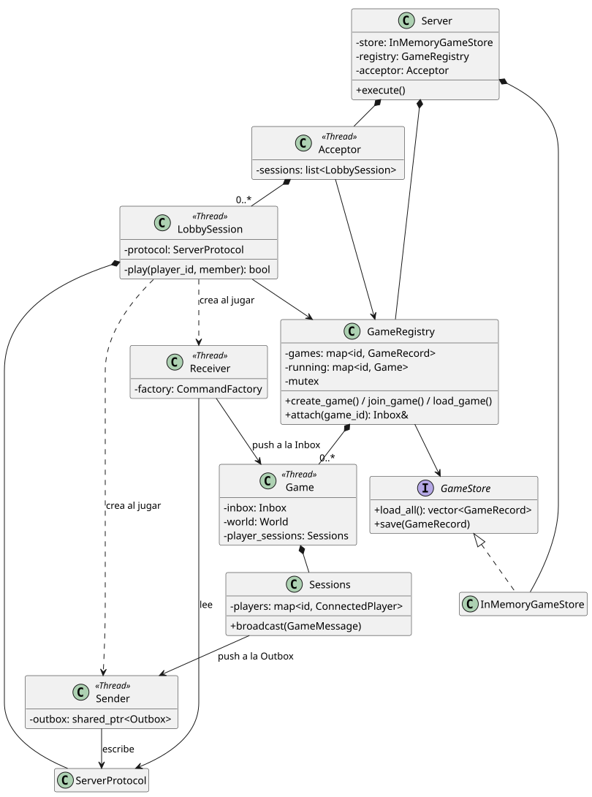
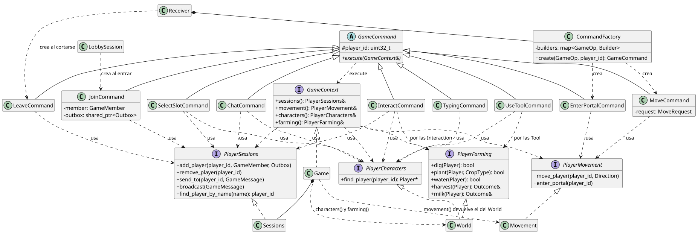
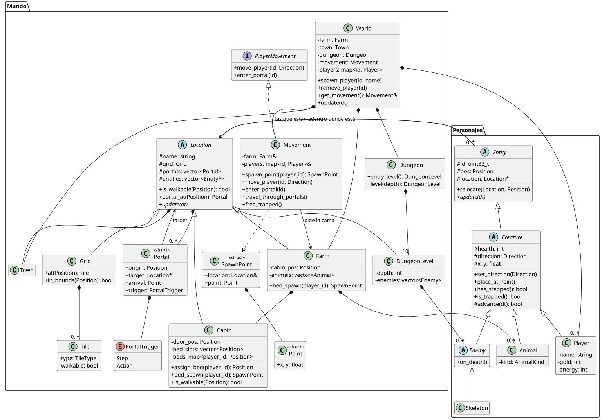
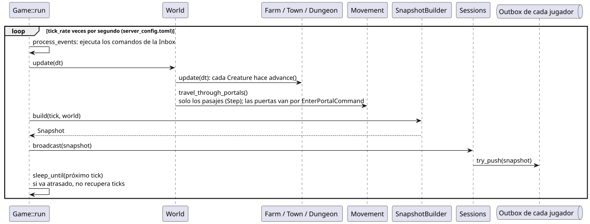
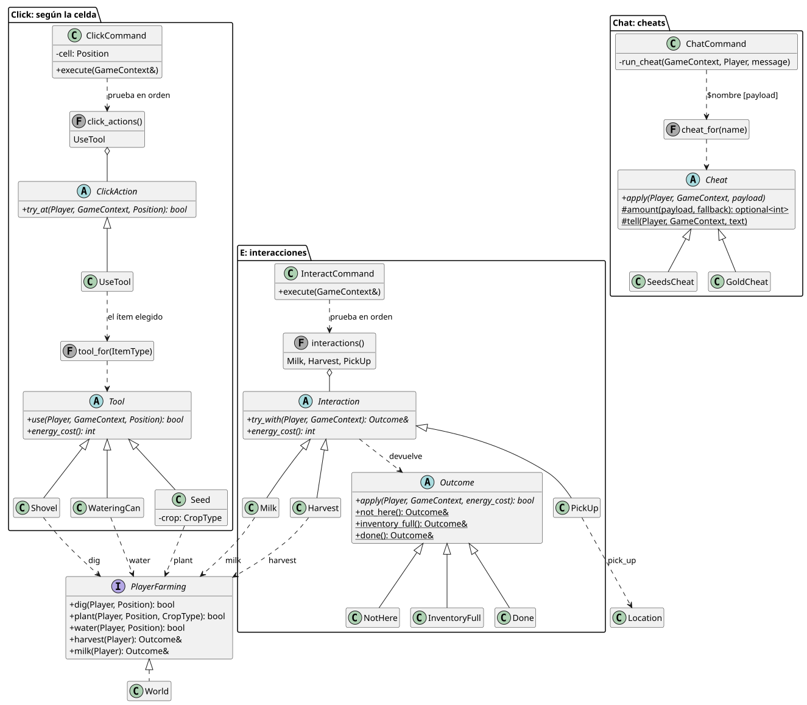

# Servidor

Cómo está armado el servidor: qué clases hay, quién es dueño de quién y qué hilo toca qué.

Cada diagrama tiene su carpeta en `diagrams/`, con el código PlantUML (`.puml`) y la imagen ya
generada (`.svg`), que es la que se ve acá. Si cambiás un `.puml`, regenerá su `.svg`: con la
extensión PlantUML de VS Code (`Export Current Diagram`, en formato svg) o con
`java -jar plantuml.jar -tsvg diagrams/<nombre>/<nombre>.puml`. Los diagramas de clases usan
`!pragma layout smetana`, así que no hace falta tener Graphviz instalado.

- [Vista general y hilos](#vista-general-y-hilos)
- [Comandos del jugador](#comandos-del-jugador)
- [Mundo y personajes](#mundo-y-personajes)
- [Un tick de la partida](#un-tick-de-la-partida)
- [Energía y fin del día](#energía-y-fin-del-día)
- [La granja](#la-granja)
- [Cheats](#cheats)
- [Interiores: la cabaña y el mercado](#interiores-la-cabaña-y-el-mercado)

## Vista general y hilos

Fuente: [diagrams/overview/overview.puml](diagrams/overview/overview.puml)

**Hilos**:

- `Server::execute` corre en el hilo principal. Espera una `q` por entrada estándar para cerrar.
- `Acceptor` acepta conexiones y crea una `LobbySession` por cliente. Cada una tiene su hilo y atiende el lobby: login, listar mundos, crear, unirse o retomar partidas.
- Al entrar a una partida, la `LobbySession` crea un `Receiver` y un `Sender` para ese jugador y queda esperando a que termine.
  - El `Receiver` lee las acciones del socket, las convierte en comandos y las mete en la `Inbox` del `Game`.
  - El `Sender` saca mensajes de la `Outbox` del jugador y los escribe en el socket.
- `Game` tiene un hilo por partida, con el loop de ticks. **Es el único que toca el `World`**, así que el mundo no necesita locks.
- **`Game` nunca se bloquea**:
  - Lee la `Inbox` con `try_pop`.
  - `Sessions` escribe en las `Outbox` con `try_push`. Si un cliente lento llena la suya, se descartan snapshots y la partida no se frena.
- `GameRegistry` es lo único compartido entre `LobbySession`s: lo protege un `mutex`.

**De dónde sale el mundo**: al arrancar, `load_worlds` valida cada `maps/*.toml` con `MapService`. Al crear una partida, `build_world` arma el `World` desde ese mapa ya validado.

## Comandos del jugador

Fuente: [diagrams/commands/commands.puml](diagrams/commands/commands.puml)

Los comandos solo conocen `GameContext`, no `Game`. `GameContext` no tiene las acciones: devuelve una interfaz chica por tema, y cada comando usa solo la que necesita.

- `sessions()` → `PlayerSessions`: entrar, salir y mandarles mensajes a los conectados (`send_to`, `broadcast`, `find_player_by_name`). La implementa `Sessions`, que tiene los jugadores conectados: su outbox y su info.
- `movement()` → `PlayerMovement` (caminar y cruzar puertas). La implementa `Movement`, el del `World`.
- `characters()` → `PlayerCharacters`: solo los personajes por id (`find_player`). La implementa el `World`. La usan `ChatCommand`, `InteractCommand`, `UseToolCommand`, `SelectSlotCommand` y `TypingCommand`.
- `farming()` → `PlayerFarming`: las acciones de la granja (`dig`, `plant`, `water`, `harvest`, `milk`). Reciben al jugador y el dueño de los datos resuelve todo: si está en la granja, qué celda tiene adelante, qué vaca está más cerca. La implementa el `World`. La usan las herramientas y las interacciones (ver [La granja](#la-granja)).

`Game` queda con la inbox, el loop de ticks, el `World` y sus `Sessions`.

Así la interfaz no crece con cada acción, y quien valida cada acción es el dueño de los datos. En los tests, `FakeGameContext` implementa las interfaces y anota lo que le piden.

**Para sumar una acción nueva**:
1. Agregar el `GameOp` en `common/game_dto.h`.
2. Leer su payload en `ServerProtocol`.
3. Agregar el comando y su builder en `CommandFactory` (`with_payload` o `without_payload`, como `EnterPortalCommand`).
4. Agregar el método a la interfaz de su tema (por ejemplo, `PlayerMovement`). Si el tema todavía no existe, crear su interfaz, implementarla en una clase del tema (como `Sessions` o `Movement`) y sumar en `GameContext` el método que la devuelve.

Fuente: [diagrams/move_sequence/move_sequence.puml](diagrams/move_sequence/move_sequence.puml)

## Mundo y personajes

Fuente: [diagrams/world/world.puml](diagrams/world/world.puml)

**Quién es dueño de quién**:

- El `World` es dueño de las zonas y de los `Player`, que se piden por id.
- La `Farm` es dueña de la `Cabin` y de los animales.
- Cada `DungeonLevel` es dueño de sus enemigos.
- Una `Location` solo guarda punteros a las entidades que están adentro (`add_entity` / `remove_entity`).
- `Entity::relocate` es lo que la cambia de `Location`.

**Movimiento**:

- `Creature::advance` mueve en continuo (`x`, `y` en celdas con decimales) y frena contra las paredes. `pos` es la celda donde cae el centro.
- `Position` es una celda (entera): la usan la grilla, los portales y las camas. `Point` es un punto con decimales, como el centro de un personaje; `cell_of` da la celda que lo contiene y `center_of`, el centro de una celda.
- `Movement` decide:
  - dónde aparece cada jugador: centrado en su cama;
  - hacia dónde camina;
  - cuándo viaja por un portal (ver abajo);
  - a dónde va el que quedó encerrado, por ejemplo porque apareció una cama donde estaba parado (`free_trapped`).

**Portales**: cada uno tiene una celda de origen, la `Location` destino, el `Point` de llegada y cómo se usa (`PortalTrigger`):

- `Step`, los portones de los pasajes entre zonas (elementos `door`): se cruzan caminando. `travel_through_portals` los dispara en el tick si el jugador **entró** a la celda (`has_stepped`); así, quien llega parado sobre el portón de vuelta no rebota.
- `Action`, las puertas (cabaña, entrada de la mina, escaleras, salidas): el cliente manda `GameOp::EnterPortal` con la tecla X y `EnterPortalCommand` llama a `Movement::enter_portal`, que busca una puerta en la celda del jugador o en una de al lado. Sus celdas no se caminan, así nadie se mete debajo del dibujo, y se llega frenado.
- La `Farm` enlaza las dos puertas de la cabaña: se sale un tile y medio debajo de la puerta, para que el dibujo de la cabaña no tape al jugador.
- `build_world` enlaza el resto (granja ↔ pueblo ↔ mazmorra) con las transiciones del mapa, con la llegada en el centro de la celda.

**Snapshot**: `SnapshotBuilder::build(tick, world)` pasa el `World` a lo que viaja al cliente, en milésimas de celda. Arma un `PlayerState` por jugador (con `unconscious` si está desmayado) y un `EntityState` por jugador, animal y cama con dueño. El estado de la granja no va en cada snapshot: viaja en un `FarmState` aparte, solo cuando cambia (ver [La granja](#la-granja)).

## Un tick de la partida

Fuente: [diagrams/tick_sequence/tick_sequence.puml](diagrams/tick_sequence/tick_sequence.puml)

## Energía y fin del día

El día dura 1200 minutos de juego (de 6:00 a 2:00), y `GameClock` los reparte en `day_speed` segundos reales.

- Cada acción cansa lo suyo: los costos están en `[energy]` de `server_config.toml`. Los gasta `Player::spend_energy`, que no baja de 0, así que la última acción se hace aunque no le alcance.
- Con `tired_energy` (10%) o menos de su energía, el jugador camina a mitad de velocidad (`Player::speed`).
- Sin energía o sin vida queda **inconsciente** (`is_unconscious`): no camina, y `UseToolCommand` e `InteractCommand` no hacen nada hasta el día siguiente.
- El día termina a las 2:00, o antes si todos los conectados están inconscientes (`World::everyone_unconscious`, que adelanta el reloj con `GameClock::end_day`).
- Al empezar el día, `World::start_new_day` despierta a todos en su cama (`Player::wake_up`). Los que estaban parados sobre su propia cama (`Cabin::is_in_bed`) y conscientes recuperan toda la vida y la energía. Los demás despiertan con `bad_night_recovery` (la mitad).

Pendiente: que todos los jugadores den el Ok antes de empezar el día siguiente.

## La granja

Fuente: [diagrams/farming/farming.puml](diagrams/farming/farming.puml)

**Dos formas de actuar**, cada una con su mensaje del cliente:

- **Herramientas**, con el click (`GameOp::UseTool`): depende de lo que tiene en el slot elegido. `tool_for(ItemType)` da la `Tool` de ese objeto, o ninguna. Cada una sabe qué hace (`use`) y cuánto cansa (`energy_cost`):
  - `Shovel`: cava la celda de adelante. Pasto → `Dirt` → `Tilled`.
  - `WateringCan`: riega el cultivo de adelante.
  - `Seed`: planta en tierra `Tilled` vacía y gasta una semilla. Hay una por cada tipo de semilla.
- **Interacciones**, con la E (`GameOp::Interact`): depende de lo que hay cerca. `interactions()` las prueba en orden (`Milk`, `Harvest`, `PickUp`) hasta que una aplica. Cada una devuelve un `Outcome` (`not_here`, `inventory_full`, `done`), y es el `Outcome` el que cobra la energía y le avisa al jugador. Por eso `InteractCommand` no tiene ifs.

Las dos son objetos sin estado. Para sumar una herramienta o una interacción nueva, se agrega su clase y se registra en `tool_for` o en `interactions()`. Si necesita tocar la granja, su acción va en `PlayerFarming`.

**Cultivos** (`Crop`, en cada `Plot` de la `Farm`). Los datos de cada tipo están en `[crops.<tipo>]`:

- **Riego**: el día se parte en `waterings_per_day` ventanas. Una ventana que se cierra sin riego cuenta como salteada. `Farm::update_time` las abre y las cierra con la hora del reloj.
- **Crecimiento**: al empezar el día, el cultivo crece si salteó como mucho `skippable_waterings` riegos. Está listo a los `days_to_grow` días. La etapa que se dibuja se reparte entre los sprites, y la última solo aparece cuando está listo.
- **Cosecha** (`Farm::harvest`): le da el producto al jugador. Si no le entra en el inventario, el cultivo queda donde está. Los que vuelven a dar (`regrow_days`) retroceden esos días; los demás dejan la tierra vacía.
- **Calidad**: un puntaje de 0 a 1 que combina qué tan rápido se regó (`watering_weight`) y qué tan rápido se cosechó (llega a 0 a los `harvest_grace_days`), multiplicado por la suerte (`luck_min`..`luck_max`). Los umbrales `good`..`perfect` de `[crops.quality]` lo pasan a `ItemQuality`.

**Animales**: la `Farm` es dueña de las vacas y las gallinas.

- La vaca se ordeña con la E (`milk_nearest_cow`: la más cercana dentro de `milking_reach`) cada `production_days`.
- La gallina pone el huevo sola, a una hora al azar del día. `Farm::collect_drops` lo levanta con `Animal::take_drop` y lo deja en el piso, en su celda.

**Objetos en el piso**: los guarda cualquier `Location` (`drop`, `get_ground_items`), así sirven para cualquier zona. `PickUp` levanta el de la celda del jugador o el de la que tiene adelante (`Location::pick_up`).

**`FarmState`**: las celdas trabajadas (suelo, cultivo, etapa, si necesita riego, si está listo) y los objetos en el piso de la granja. Se manda solo cuando algo cambió (`Location::take_changes`). Los objetos en el piso de otras zonas todavía no viajan al cliente.

## Cheats

Se escriben en el chat como `$nombre [cantidad]`. `ChatCommand` separa el nombre del payload y busca el `Cheat` con `cheat_for`. Si no existe, le avisa solo al que lo escribió.

- `$seeds [n]`: n semillas de cada tipo (por defecto, `[cheats] seeds`).
- `$gold [n]`: n de oro (por defecto, `[cheats] gold`).

Para sumar uno, se crea su clase con `apply(Player&, GameContext&, payload)` y se registra en `cheat_for`. Los helpers `amount` (lee la cantidad) y `tell` (le responde al jugador) están en `Cheat`.

## Interiores: la cabaña y el mercado

Cada interior es un `Interior`: una `Location` con una puerta que lleva afuera. `Interior::link_to` enlaza esa puerta con la del edificio, y las dos se usan con la tecla X. Se sale un tile y medio debajo de la puerta del edificio. La `Farm` es dueña de la `Cabin` y el `Town`, del mercado.

**La cabaña**:

- La sala es la misma en todas las partidas: `maps/interiors/cabin.toml`. Ese archivo marca solo el piso, los muebles y la puerta de salida (`house_door`).
- `loadCabinInterior(max_players)` (en `common/map/CabinInterior.h`):
  1. Lee la sala.
  2. `addBedroom` le agrega a la derecha un cuarto con un tile `sleepable` por jugador.
  3. `addWalls` (`common/map/InteriorWalls.h`) pone las paredes a partir del piso.
  
  Lo usan el servidor (para la grilla de la `Cabin`) y el cliente (para dibujarla), así que los dos ven lo mismo.
- `build_world` toma los tiles `sleepable` como lugares para camas, recorriéndolos por filas, y chequea que haya uno por jugador.
- La cama aparece cuando el jugador entra por primera vez: `Cabin::assign_bed` le da el primer lugar libre. Si sale y vuelve, conserva la misma cama.
- Al entrar a la partida, el jugador aparece centrado en su cama (`Cabin::bed_spawn`). La fila de la almohada no se camina; la de arriba sí, para pasar por detrás de la cabecera.
- Cada cama viaja en el snapshot como `EntityType::Bed`, con el `playerId` del dueño.
- Cada mañana todos despiertan en su cama (ver [Energía y fin del día](#energía-y-fin-del-día)).

**El mercado**:

- La sala es la misma en todas las partidas: `maps/interiors/market.toml`, que lee `loadMarketInterior()` (en `common/map/MarketInterior.h`). Las paredes las pone `addWalls`, como en la cabaña.
- Los cuatro comerciantes están adentro: Pierre atiende detrás del mostrador y los otros andan por la tienda. Son elementos del interior y tapan su celda como cualquier NPC.
- En el pueblo solo queda el edificio, el elemento `market`: su puerta (`doorCell`) es la que se enlaza con el interior.

**El centro comunitario** está pendiente (TODO en `Town` y en `MarketInterior.h`). Se arma igual que el mercado: un `.toml` con el piso y un `Interior` enlazado a la puerta del elemento `community_center`.
