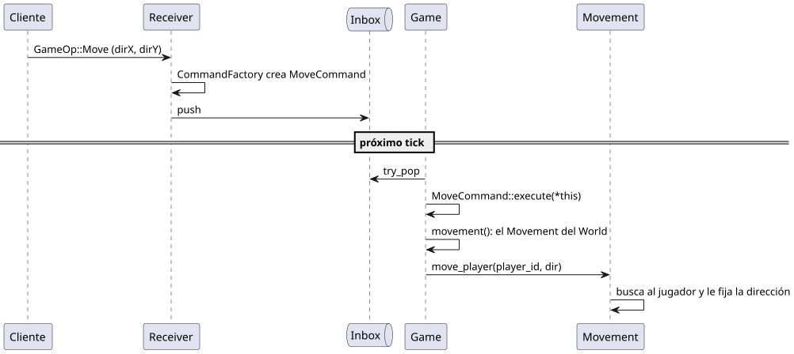

# Servidor

Cómo está armado el servidor: qué clases hay, quién es dueño de quién y qué hilo toca qué.

Cada diagrama tiene su carpeta en `diagrams/`, con el código PlantUML (`.puml`) y la imagen ya
generada (`.svg`), que es la que se ve acá. Si cambiás un `.puml`, regenerá su `.svg`: con la
extensión PlantUML de VS Code (`Export Current Diagram`, en formato svg) o con
`java -jar plantuml.jar -tsvg diagrams/<nombre>/<nombre>.puml`. Los diagramas de clases usan
`!pragma layout smetana`, así que no hace falta tener Graphviz instalado.

- [Vista general y hilos](#vista-general-y-hilos)
- [Comandos del jugador](#comandos-del-jugador)
- [Mundo y personajes](#mundo-y-personajes)
- [Un tick de la partida](#un-tick-de-la-partida)
- [Interiores: la cabaña](#interiores-la-cabaña)

## Vista general y hilos

Fuente: [diagrams/overview/overview.puml](diagrams/overview/overview.puml)

**Hilos**:

- `Server::execute` corre en el hilo principal. Espera una `q` por entrada estándar para cerrar.
- `Acceptor` acepta conexiones y crea una `LobbySession` por cliente. Cada una tiene su hilo y atiende el lobby: login, listar mundos, crear, unirse o retomar partidas.
- Al entrar a una partida, la `LobbySession` crea un `Receiver` y un `Sender` para ese jugador y queda esperando a que termine.
  - El `Receiver` lee las acciones del socket, las convierte en comandos y las mete en la `Inbox` del `Game`.
  - El `Sender` saca mensajes de la `Outbox` del jugador y los escribe en el socket.
- `Game` tiene un hilo por partida, con el loop de ticks. **Es el único que toca el `World`**, así que el mundo no necesita locks.
- **`Game` nunca se bloquea**:
  - Lee la `Inbox` con `try_pop`.
  - `Sessions` escribe en las `Outbox` con `try_push`. Si un cliente lento llena la suya, se descartan snapshots y la partida no se frena.
- `GameRegistry` es lo único compartido entre `LobbySession`s: lo protege un `mutex`.

**De dónde sale el mundo**: al arrancar, `load_worlds` valida cada `maps/*.toml` con `MapService`. Al crear una partida, `build_world` arma el `World` desde ese mapa ya validado.

## Comandos del jugador

Fuente: [diagrams/commands/commands.puml](diagrams/commands/commands.puml)

Los comandos solo conocen `GameContext`, no `Game`. `GameContext` no tiene las acciones: devuelve una interfaz chica por tema, y cada comando usa solo la que necesita.

- `sessions()` → `PlayerSessions` (entrar y salir). La implementa `Sessions`, que tiene los jugadores conectados: su outbox y su info.
- `movement()` → `PlayerMovement` (caminar y cruzar puertas). La implementa `Movement`, el del `World`.

`Game` queda con la inbox, el loop de ticks, el `World` y sus `Sessions`.

Así la interfaz no crece con cada acción, y quien valida cada acción es el dueño de los datos. En los tests, `FakeGameContext` implementa las interfaces y anota lo que le piden.

**Para sumar una acción nueva**:
1. Agregar el `GameOp` en `common/game_dto.h`.
2. Leer su payload en `ServerProtocol`.
3. Agregar el comando y su builder en `CommandFactory` (`with_payload` o `without_payload`, como `EnterPortalCommand`).
4. Agregar el método a la interfaz de su tema (por ejemplo, `PlayerMovement`). Si el tema todavía no existe, crear su interfaz, implementarla en una clase del tema (como `Sessions` o `Movement`) y sumar en `GameContext` el método que la devuelve.

Fuente: [diagrams/move_sequence/move_sequence.puml](diagrams/move_sequence/move_sequence.puml)

## Mundo y personajes

Fuente: [diagrams/world/world.puml](diagrams/world/world.puml)

**Quién es dueño de quién**:

- El `World` es dueño de las zonas y de los `Player`, que se piden por id.
- La `Farm` es dueña de la `Cabin` y de los animales.
- Cada `DungeonLevel` es dueño de sus enemigos.
- Una `Location` solo guarda punteros a las entidades que están adentro (`add_entity` / `remove_entity`).
- `Entity::relocate` es lo que la cambia de `Location`.

**Movimiento**:

- `Creature::advance` mueve en continuo (`x`, `y` en celdas con decimales) y frena contra las paredes. `pos` es la celda donde cae el centro.
- `Position` es una celda (entera): la usan la grilla, los portales y las camas. `Point` es un punto con decimales, como el centro de un personaje; `cell_of` da la celda que lo contiene y `center_of`, el centro de una celda.
- `Movement` decide:
  - dónde aparece cada jugador: centrado en su cama;
  - hacia dónde camina;
  - cuándo viaja por un portal (ver abajo);
  - a dónde va el que quedó encerrado, por ejemplo porque apareció una cama donde estaba parado (`free_trapped`).

**Portales**: cada uno tiene una celda de origen, la `Location` destino, el `Point` de llegada y cómo se usa (`PortalTrigger`):

- `Step`, los portones de los pasajes entre zonas (elementos `door`): se cruzan caminando. `travel_through_portals` los dispara en el tick si el jugador **entró** a la celda (`has_stepped`); así, quien llega parado sobre el portón de vuelta no rebota.
- `Action`, las puertas (cabaña, entrada de la mina, escaleras, salidas): el cliente manda `GameOp::EnterPortal` con la tecla X y `EnterPortalCommand` llama a `Movement::enter_portal`, que busca una puerta en la celda del jugador o en una de al lado. Sus celdas no se caminan, así nadie se mete debajo del dibujo, y se llega frenado.
- La `Farm` enlaza las dos puertas de la cabaña: se sale un tile y medio debajo de la puerta, para que el dibujo de la cabaña no tape al jugador.
- `build_world` enlaza el resto (granja ↔ pueblo ↔ mazmorra) con las transiciones del mapa, con la llegada en el centro de la celda.

**Snapshot**: `SnapshotBuilder::build(tick, world)` pasa el `World` a lo que viaja al cliente, en milésimas de celda. Arma un `PlayerState` por jugador y un `EntityState` por jugador, animal y cama con dueño.

## Un tick de la partida

Fuente: [diagrams/tick_sequence/tick_sequence.puml](diagrams/tick_sequence/tick_sequence.puml)

## Interiores: la cabaña

- La sala es la misma en todas las partidas: `maps/interiors/cabin.toml`. Ese archivo marca solo el piso, los muebles y la puerta de salida (`house_door`).
- `loadCabinInterior(max_players)` (en `common/map/CabinInterior.h`):
  1. Lee la sala.
  2. `addBedroom` le agrega a la derecha un cuarto con un tile `sleepable` por jugador.
  3. `addWalls` (`common/map/InteriorWalls.h`) pone las paredes a partir del piso.
  
  Lo usan el servidor (para la grilla de la `Cabin`) y el cliente (para dibujarla), así que los dos ven lo mismo.
- `build_world` toma los tiles `sleepable` como lugares para camas, recorriéndolos por filas, y chequea que haya uno por jugador.
- La cama aparece cuando el jugador entra por primera vez: `Cabin::assign_bed` le da el primer lugar libre. Si sale y vuelve, conserva la misma cama.
- Al entrar a la partida, el jugador aparece centrado en su cama (`Cabin::bed_spawn`). La fila de la almohada no se camina; la de arriba sí, para pasar por detrás de la cabecera.
- Cada cama viaja en el snapshot como `EntityType::Bed`, con el `playerId` del dueño.
- `addWalls` sirve para cualquier interior, como el mercado y el centro comunitario: alcanza con un `.toml` que marque el piso.
